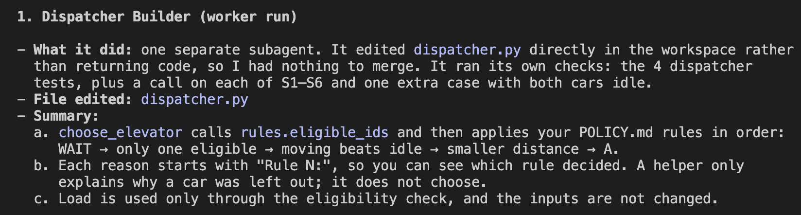
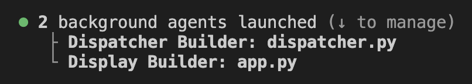
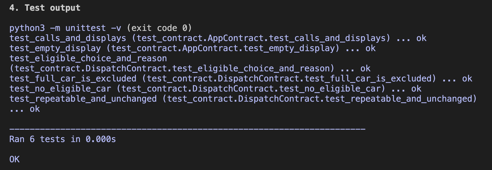
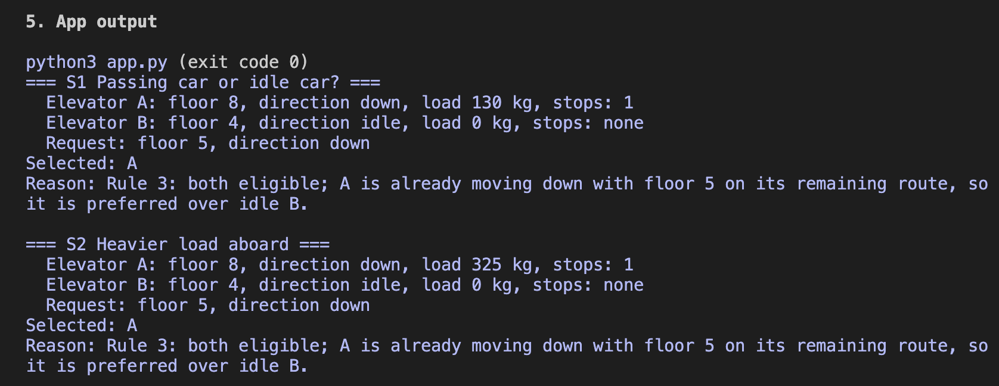
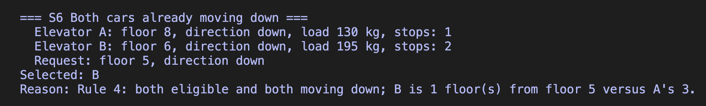

# My experiment results

Fill in this template with actual observations. Short bullets are sufficient.

Name / student ID: Waranyu Chunhachatcharachai 6681376

Tool, visible software version and model(s): Claude code version: 2.1.329, Opus 5.5

Route: automatic workers (two Claude Code subagents launched from one session)

## Agent outputs

| Role | What it delivered | Brief excerpt or screenshot link |
|---|---|---|
| Dispatcher builder | Implemented choose_elevator in dispatcher.py following my 5 rules; reasons start with "Rule N:" |  |
| Display builder | Implemented run_scenarios in app.py; shows states, request, Selected and reason |  |
| Reviewer | [finding or no-defect conclusion] | [evidence] |

- Two separate worker runs: 
- Tests: 
- App output:  

## Compare with my predictions

Run `python app.py` after adding S6. Compare with the predictions you wrote in POLICY.md before implementation.

| Scenario | Expected selection | Actual selection and reason | Matches my policy? |
|---|---|---|---|
| S1 | A | A — "Rule 3: both eligible; A is already moving down with floor 5 on its remaining route, so it is preferred over idle B." | Yes, rule 3 (moving beats idle) |
| S2 | A | A — "Rule 3: …preferred over idle B." (same reason as S1; 325 kg + 65 ≤ 520 so A is eligible) | Yes, rule 3; load ignored beyond eligibility, as my policy states |
| S6 | B | B — "Rule 4: both eligible and both moving down; B is 1 floor(s) from floor 5 versus A's 3." | Yes, rule 4 (smaller distance) |

- Supplied suite command and actual result: `python3 -m unittest -v` → Ran 6 tests, OK
- One review finding or concern I checked: [rule/policy, function, evidence, my decision]
- Change made, if needed: [code change, policy revision with reason, or why no change was needed]
- Does my policy serve my stated priority? [use one scenario; acknowledge a cost or limitation]
- What did I have to coordinate between the agents? [one concrete observation]
