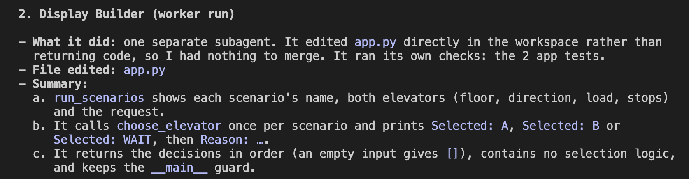
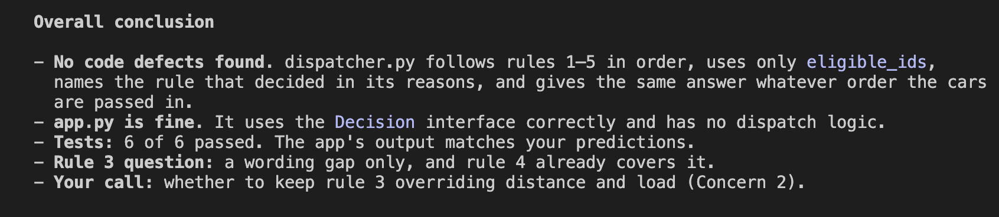
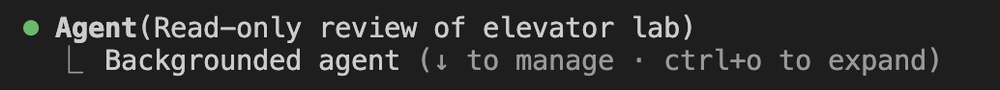
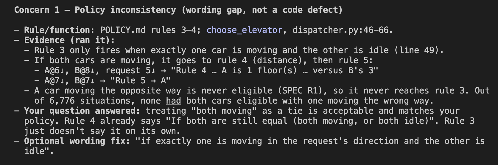

# My experiment results

Name / student ID: Waranyu Chunhachatcharachai 6681376

Tool, visible software version and model(s): Claude code version: 2.1.329, Opus 5.5

Route: automatic workers (two Claude Code subagents launched from one session)

## Agent outputs

| Role | What it delivered | Brief excerpt or screenshot link |
|---|---|---|
| Dispatcher builder | Implemented choose_elevator in dispatcher.py following my 5 rules; reasons start with "Rule N:" |  |
| Display builder | Implemented run_scenarios in app.py; shows states, request, Selected and reason |  |
| Reviewer | No code defects; 1 policy wording gap (rule 3 when both cars move) and 1 tradeoff (rule 3 ignores distance/load) |  |

- Two separate worker runs: 
- Tests: 
- App output:  
- Separate reviewer run: 
- Reviewer concerns: 

## Compare with my predictions

Run `python app.py` after adding S6. Compare with the predictions you wrote in POLICY.md before implementation.

| Scenario | Expected selection | Actual selection and reason | Matches my policy? |
|---|---|---|---|
| S1 | A | A — "Rule 3: both eligible; A is already moving down with floor 5 on its remaining route, so it is preferred over idle B." | Yes, rule 3 (moving beats idle) |
| S2 | A | A — "Rule 3: …preferred over idle B." (same reason as S1; 325 kg + 65 ≤ 520 so A is eligible) | Yes, rule 3; load ignored beyond eligibility, as my policy states |
| S6 | B | B — "Rule 4: both eligible and both moving down; B is 1 floor(s) from floor 5 versus A's 3." | Yes, rule 4 (smaller distance) |

- Supplied suite command and actual result: `python3 -m unittest -v` → Ran 6 tests, OK
- One review finding or concern I checked: POLICY.md rule 3 / choose_elevator. I asked what happens when
  both cars are moving. The reviewer ran A@6↓, B@8↓, request 5↓ → Rule 4 picks A (nearer), and
  A@7↓, B@7↓ → Rule 5 picks A. Wording gap, not a code defect: the code does what I intended (S6 depends
  on it). Decision: clarify the wording only.
- Change made, if needed: Policy wording only. Rule 3 now says "exactly one moving and the other idle; if
  both moving or both idle, go to rule 4". No code change needed because the behaviour was already correct.
  Original wording is kept in the earlier commit. Reran: 6 tests OK, same selections.
- Does my policy serve my stated priority? Yes. In S1 and S2 it reuses A's existing journey and keeps B free.
  Cost: in S2 about 5 passengers (325/65) get an extra stop. In the reviewer's case (A@8↓ with 455 kg vs
  idle B already at floor 5) my policy still sends A, so the caller waits for 3 floors instead of 0 and A
  ends up exactly full. I accept this tradeoff (Concern 2) as the price of my priority, not a bug.
- What did I have to coordinate between the agents? The builders ran in a folder that wasn't the git repo
  I had pushed, so the coordinator couldn't use git diff and compared file fingerprints instead. I had to
  make the working folder and the GitHub repo the same before review. I also started the reviewer in a fresh
  session without the builders' "it works" claims, so it checked the files itself.
